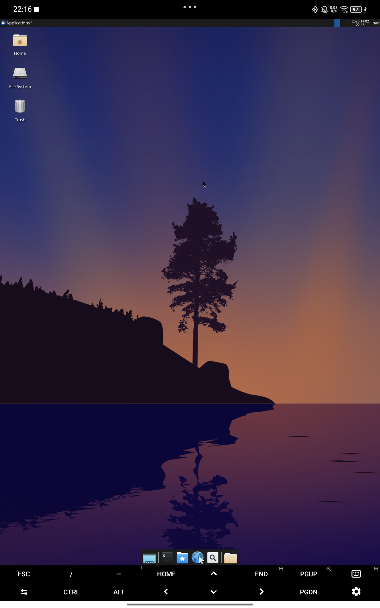

# termux-chroot-desktop

> 在一台 Android 平板上，用 chroot 跑起带 **GPU 硬件加速**的 Ubuntu 桌面。
> 完整记录从「能跑」到「能看」之间踩过的每一个坑。



## 这是什么

一套在 **Termux + TMOE Linux** 之上工作的启动/停止/接入脚本，用于：

- 以 **chroot** 方式运行 Ubuntu（本项目验证于 26.04 LTS）
- 通过 **Mesa 的 KGSL 后端**让 Adreno GPU 真正参与渲染（不是 llvmpipe 软渲染）
- 通过 **Termux:X11** 把 X11 桌面显示到 Android 屏幕上
- 用**私有挂载命名空间**做挂载隔离，退出即销毁，不会污染系统

不包含：内核、ROM、root 方案。前提见 [docs/01-prerequisites.md](docs/01-prerequisites.md)。

## 快速开始

```bash
# 1. 安装脚本
bash install.sh

# 2. 启动（首次会自动拉起 X 服务与 Termux:X11 应用）
bash ~/bin/termux-gui-start.sh

# 3. 进容器终端
bash ~/bin/termux-gui-attach.sh

# 4. 停止
bash ~/bin/termux-gui-stop.sh
```

可选：想要窗口阴影与透明效果

```bash
COMPOSITOR=picom bash ~/bin/termux-gui-start.sh
```

## Termux:Widget 一键入口

加 `--widget` 安装，会在 `~/.shortcuts` 下生成三个入口，桌面 widget 里直接点：

```bash
bash install.sh --widget
```

| 入口 | 位置 | 行为 |
|---|---|---|
| `start-desktop` | `~/.shortcuts/tasks/` | 后台启动桌面，不弹终端 |
| `stop-desktop` | `~/.shortcuts/tasks/` | 后台停止 |
| `attach-terminal` | `~/.shortcuts/` | 打开终端进容器 |

`tasks/` 是 Termux:Widget 的「静默执行」目录；需要交互的 `attach` 必须放外层，
否则没有终端可输。

## 故事线：四个门槛

这个项目不是一个“写个脚本就好了”的任务。它依次撞上了四堵墙，每一堵都值得单独写一章：

| 章节 | 问题 | 结论 |
|---|---|---|
| [02](docs/02-gpu-acceleration.md) | chroot 能跑，但 GPU 完全用不上 | `/dev/dri` 是显示控制器，不是 3D；必须走 **KGSL** 后端 |
| [03](docs/03-compositor.md) | 桌面连上了，画面却是白屏 | **xfwm4 的 GLX 合成**与 Xlorie 不兼容；改用 picom 的 xrender 后端 |
| [04](docs/04-mount-safety.md) | 一次事故：789 个挂载泄漏、系统级崩溃 | 必须 `--make-rprivate` + 校验，否则 `unshare -m` 会反向污染父命名空间 |
| [05](docs/05-tmoe-integration.md) | 自写脚本绕开了 TMOE 的配置 | **读取** TMOE 配置，但**不接管**它的启动器 |

## 硬件与验证环境

| 项目 | 值 |
|---|---|
| 设备 | Lenovo TB331FC |
| SoC | Qualcomm bengal（SM6225），Adreno 610 |
| 系统 | Android 15（SDK 35），内核 5.15.167-android13 GKI |
| Root | KernelSU |
| 容器 | TMOE Linux，Ubuntu 26.04 LTS（`ubuntu-resolute_arm64`） |
| 显示 | Termux:X11，1200×1920 |

性能实测（glmark2-es2，640×480，chroot 内直跑）：

```
[build]   use-vbo=true       1010 FPS
[texture] nearest             997 FPS
[shading] phong               991 FPS
[desktop] blur x4             687 FPS
[buffer]  subdata             261 FPS   ← 顶点上传瓶颈项
```

## 仓库结构

```
.
├── install.sh                 # 安装脚本到 ~/bin
├── scripts/
│   ├── termux-gui-lib.sh      # 解析 TMOE 配置（挂载点 / 用户）
│   ├── termux-gui-start.sh    # 启动：X 服务 + 私有命名空间 + 桌面
│   ├── termux-gui-stop.sh     # 停止：进程组 + 挂载 + X 服务
│   └── termux-gui-attach.sh   # 进入容器终端（交互或单命令）
└── docs/
    ├── 01-prerequisites.md    # 环境前提与依赖
    ├── 02-gpu-acceleration.md # KGSL 后端：为什么必须是它
    ├── 03-compositor.md       # 白屏之谜：合成器的 A/B 实验
    ├── 04-mount-safety.md     # 挂载命名空间事故复盘
    ├── 05-tmoe-integration.md # 与 TMOE 的分工
    ├── 06-troubleshooting.md  # 排障手册
    ├── 07-electron-apps.md    # Electron/VS Code 起不来的原因
    └── 08-firefox.md          # 安装非 snap 版 Firefox
```

## 已知限制

- **合成器只能用 xrender（CPU）**。GLX 合成（xfwm4 内置或 picom glx）都会导致白屏/黑屏。
- 应用自身的 GPU 加速不受影响：关合成不代表应用回退到软件渲染。
- 桌面默认以 TMOE 的主用户（如 `pad`，UID 1001）运行；在 Android 侧该 UID 会显示为 `radio`，属于正常现象。
- 不支持 systemd 管理服务（chroot 内没有 cgroup 委托），需要服务请用 s6/runit 或手动启动。

## License

MIT
