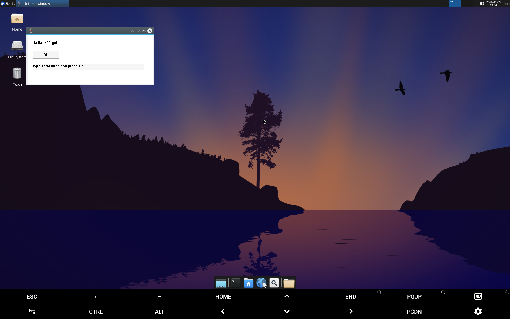

# IA-32 双后端 Spike（M3.0）

日期：2026-11-09
设备：Lenovo TB331FC / SM6225 / Adreno 610 / Android 15 / KernelSU
环境：Ubuntu 26.04 ARM64 chroot + Hangover 11.16 + 单一 Wine Prefix

本阶段只做验证：**不修改正式 `win-run` 的 I386 拒绝逻辑**，不换 Hangover 版本，不引入 DXVK。

## 1. 版本与组件

| 组件 | 版本 / 证据 |
|---|---|
| hangover-wine | `11.16~resolute` |
| hangover-wowbox64 | `11.16`（运行日志：`WowBox64 arm64 v0.4.4`） |
| hangover-libwow64fex | `11.16`（运行日志：`starting FEX ... based libwow64fex.dll`） |
| 交叉编译器 | `i686-w64-mingw32-gcc 13-win32` |
| 测试 Prefix | `/tmp/ia32-spike/prefix`（临时，避免污染正式 Prefix） |

## 2. 方法

1. 两条路径使用**同一批 I386 PE**，只通过环境变量切换后端：
   - Box64：默认行为（Hangover 的 `wowbox64.dll`）
   - FEX：`HODLL=libwow64fex.dll`
2. 每次切换后端前执行 `wineserver -k` 并确认 wineserver 数量为 0，避免状态混用。
3. 后端是否真正参与，以**日志**为准，不看退出码：
   - `[BOX64] WowBox64 arm64 v0.4.4 (Hangover 11.16)`
   - `starting FEX (Hangover 11.16) based libwow64fex.dll`
4. 初步比较在临时 Prefix 中进行；最后在**正式 Prefix** 复核两条路径。
5. 窗口存在性用进程级检测（`/proc/*/cmdline` 含 `gui_test.exe`），
   因为 Wine 会创建 `Default IME` 辅助窗口，且标题属性在部分路径下不可靠（见 §6）。

## 3. 测试程序（I386 PE）

| 程序 | 用途 |
|---|---|
| `hello.exe` | 启动、退出码 |
| `args_test.exe`（`wmain`） | 参数保真：空格、中文、引号 |
| `file_test.exe` | Z: 盘读写 |
| `gui_test.exe`（`gui32_test.c`） | 真 Win32 窗口 + 输入框 + 按钮 + 回调 + 退出码 |
| `probe.exe` | 窗口创建分层探针（`STATIC` / 自定义类 / `MessageBox`） |

源码与构建脚本：`tests/windows/ia32/`。

## 4. 结果

| 测试 | Box64 | FEX |
|---|---|---|
| 控制台启动 | PASS | PASS |
| 退出码精确（返回 5 → rc=5） | PASS | PASS |
| 参数（空格/中文/引号） | PASS | PASS |
| Z: 盘读写 | PASS | PASS |
| Win32 GUI 窗口 | PASS（截图） | PASS（截图） |
| 按钮回调 + 退出码 | PASS（`GUI_BUTTON` / `GUI_EXIT 0`） | PASS |
| 正式 Prefix 复核 | PASS | PASS |
| 多实例（2 窗口 1 wineserver） | PASS | PASS |
| 关闭其一，另一个存活 | PASS | PASS |
| stop → start 后可用 | PASS | PASS |
| 后端日志证据 | PASS（`[BOX64] ... v0.4.4`） | PASS（`starting FEX ... libwow64fex.dll`） |
| 音频 | NOT TESTED | NOT TESTED |
| 中文输入法 | NOT TESTED | NOT TESTED |
| Direct3D / 游戏 | NOT TESTED | NOT TESTED |

## 5. 性能与内存

| 指标 | Box64 | FEX |
|---|---|---|
| 控制台 冷启动 | 1311 ms | 1311 ms |
| 控制台 热启动 | 209 ms | 209 ms |
| GUI（程序自身存活 8 s） | 11720 ms | 11922 ms |
| 推算启动开销（GUI − 8 s） | ≈ 3.7 s | ≈ 3.9 s |
| GUI 运行内存（wineserver + 程序 RSS） | ≈ 78 MB | ≈ 118 MB |

冷启动两者完全相同，说明主要开销在 **wineserver/prefix 初始化**，而不是模拟器本身。

## 6. 兼容性发现

1. **GUI 测试一开始全部失败，但根因不是后端**：当时桌面 X 会话已经死亡
   （主机 `$PREFIX/tmp/.X11-unix` 不存在，容器里只剩陈旧 socket），
   `CreateWindowW` 全部返回 NULL。重启会话后，两条路径的窗口都恢复正常。
   教训：GUI 矩阵测试前必须先验证 X 会话存活（`xdpyinfo`/`xdotool getdisplaygeometry`）。

2. **Wine 会产生 `Default IME` 辅助窗口**，其 `WM_CLASS` 也包含 `gui_test.exe`，
   导致 `xdotool search --classname` 可能先命中 IME 窗口、读到错误的标题。
   因此本 Spike 的窗口存在性改走进程检测。

3. **窗口标题保真未定论**：在 Box64 的一次采样中主窗口 `WM_NAME`/`_NET_WM_NAME` 为空；
   在 FEX 的一次采样中命中的是 `Default IME`。这可能是采样目标错误，也可能是
   IA-32 路径的 Unicode 标题传递问题。标记为 **NOT TESTED**，M3.1 应专门验证。

4. 两条路径的控制台行为高度一致（rc、参数、文件访问均相同），
   差异主要体现在内存占用（Box64 更低）。

## 7. 结论与默认后端建议

- **两条路径都可以作为正式 IA-32 后端**，控制台与 GUI 均通过真机验证。
- 建议 M3.1 默认使用 **Box64（WowBox64）**：
  1. 它是 Hangover 打包结构里的默认 WoW64 后端（`hangover-wow64box64` 为强依赖）；
  2. 内存占用明显更低（≈78 MB vs ≈118 MB）；
  3. 启动性能与 FEX 相同；
  4. FEX 路径保留为 `HODLL=libwow64fex.dll` 覆盖选项，便于兼容性排查。
- 该建议**不是**基于单一指标：GUI、退出码、参数、文件、多实例、生命周期五项均相同，
  只有内存有可测差异。

## 8. 未决问题

1. 窗口标题/IME 问题需要专门测试（`WM_NAME` 是否正确传递中文/Unicode 标题）。
2. IA-32 程序的音频输出未测。
3. 长时间运行稳定性、内存增长未测。
4. 未测试需要特定 DLL 或安装器的真实应用。
5. 未比较两条路径在 Direct3D 场景下的表现（属于 M4）。
