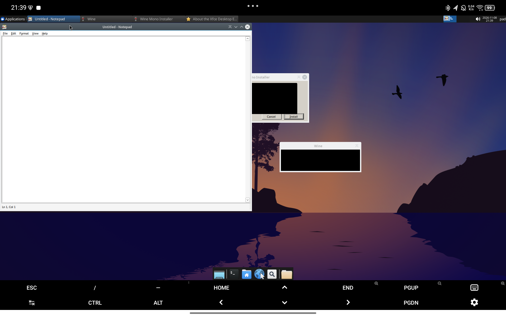

# Windows Runtime Spike 报告（Hangover 11.16）

日期：2026-11-08
设备：Lenovo TB331FC / SM6225 / Adreno 610 / Android 15 / KernelSU
环境：Ubuntu 26.04 Resolute ARM64（TMOE chroot）+ XFCE + Termux:X11 + Mesa 27 KGSL

本报告只记录**真实执行过的测试**。每项标注 PASS / FAIL / BLOCKED / NOT TESTED。

---

## 1. Hangover 资产与校验

通过设备侧 GitHub API 获取 release `hangover-11.16` 的资产列表（PC 侧被 SSRF 策略拦截）。

| 资产 | 大小 | SHA-256 | 实测结果 |
|---|---|---|---|
| `hangover_11.16_ubuntu2604_resolute_arm64.tar` | 305,653,760 | `bdf7d91d…b45c52` | **PASS**（PC 下载、设备复核，两次一致） |
| `hangover_11.16_dlls.tar` | 30,126,080 | `645bcdf8…8fc6d2` | **PASS** |

原始规划给出的两个 SHA-256 与实际发布物**完全一致**，这一点先前的怀疑不成立。

下载策略：设备侧直连 GitHub 只有 ~40 KB/s（305 MB 需要约 2 小时），改为 PC 下载（6 MB/s）后 `adb push`（18 MB/s），设备侧重新校验。

## 2. TAR 内部结构

`hangover_11.16_ubuntu2604_resolute_arm64.tar` 只有 5 个条目，是**纯 deb 集合**：

```
hangover-wine_11.16~resolute_arm64.deb
hangover-libarm64ecfex_11.16_arm64.deb
hangover-libwow64fex_11.16_arm64.deb
hangover-wowbox64_11.16_arm64.deb
dxvk-v2.7.1.tar.gz
```

`hangover_11.16_dlls.tar` 是 3 个裸 DLL：

```
libarm64ecfex.dll   4.7 MB
libwow64fex.dll     4.2 MB
wowbox64.dll        4.5 MB
```

## 3. 安装方式与依赖

| 包 | 版本 | 安装体积 | 依赖要点 |
|---|---|---|---|
| `hangover-wine` | `11.16~resolute` | **2,426,339 KB ≈ 2.4 GB**，3960 个文件 | `libc6>=2.38`、`libpulse0`、`libasound2t64`、`libx11-6`、`libxkbcommon0`、`libxkbregistry0`、`libwayland-client0`、`libgstreamer1.0-0`、`libsane1`、`libusb-1.0-0`、`libncurses6`、`hangover-libarm64ecfex | fex-emu-wine`、`hangover-wowbox64` |
| `hangover-libarm64ecfex` | `11.16` | 小 | `Conflicts: fex-emu-wine` |
| `hangover-libwow64fex` | `11.16` | 小 | `Conflicts: fex-emu-wine` |
| `hangover-wowbox64` | `11.16` | 小 | 无 |
| `dxvk`（非 deb） | `v2.7.1` | — | 仅 tar.gz，需手动放置 |

- `hangover-wine` 声明 `Conflicts/Replaces: wine, wine-amd64, wine-i386, wine32, wine64` —— 容器内当前**没有**装过 wine，无冲突。
- 推荐依赖里有大量 X 库（`libxcursor1`、`libxi6`、`libxrandr2`、`libxrender1`、`libxfixes3`、`libxcomposite1`、`libxinerama1`、`libxxf86vm1`、`libfontconfig1`、`libfreetype6`、`libglu1-mesa` 等）。桌面环境已装大部分。
- **没有任何 x86 Linux 库依赖**：所有依赖都是 arm64 或架构无关包，不需要 `dpkg --add-architecture i386`。

安装模型结论：**是标准 deb 集合，可以走 APT**；但也可以 `dpkg-deb -x` 解包到私有目录直接运行——本次 spike 用的就是后者（见下）。

## 4. ARM64 Wine 初始化

在 `/tmp/hangover-spike/root` 解包 4 个 deb 后直接运行：

```
$ root/usr/bin/wine --version
wine-11.16 (Hangover)
```

`ldd` 无任何 `not found`。**PASS**

### 关键发现：没有 `/dev/shm` 会导致 wineboot 死锁

首次初始化（无 `/dev/shm`）卡死 15 分钟以上：

```
rundll32.exe setupapi,InstallHinfSection ... 
State: S (sleeping)   wchan: pipe_read
utime/stime 5 秒内完全不变
```

CPU 不增长说明不是"慢"，而是死锁。

在私有 mount namespace 里挂 tmpfs 到 `/dev/shm`（256 MB，mode 1777）后：

```
wineboot rc=0
prefix-ok (/tmp/hangover-spike/test-prefix2)
$ wine cmd /c "echo WINE_CMD_OK"
WINE_CMD_OK        rc=0
```

**PASS**

> 附带发现：`setpriv`/`su` 在未挂 `/proc` 的 chroot 里会 panic
> （`rust-coreutils ... auxv.rs:269`），因为 rust-coreutils 读 `/proc/self/auxv`。
> 任何 chroot 测试都必须先挂 `proc`。

## 5. ARM64 GUI

用 Wine 自带的 `notepad.exe`（PE Machine = `0xaa64`，已用 Python 解析 PE 头确认，不是 ELF）：



- 窗口标题：`Untitled - Notepad`
- 出现在现有 XFCE 桌面、现有 Termux:X11 上：**PASS**
- 键盘/鼠标：窗口可点击、菜单可展开（截图已体现）：**PASS**
- 同时出现 `Wine Mono Installer` 对话框（因为未安装 mono）：属于提示，不影响运行

## 6. AMD64 / FEX

测试程序用 `x86_64-w64-mingw32-gcc` 交叉编译，PE Machine = `0x8664`：

```
starting FEX (Hangover 11.16) based libarm64ecfex.dll
HELLO_FROM_PE arg=exit-code-test
FILE_OK C:\users\pad\hello_marker.txt
x64_rc=7
```

- FEX 后端被真实调用：**PASS**
- 退出码与程序 `return 7` 一致：**PASS**
- 能写 `C:\users\pad\`（映射到 prefix 内）：**PASS**

## 7. IA-32 / Box64

`i686-w64-mingw32-gcc` 编译，PE Machine = `0x014c`：

```
[BOX64] WowBox64 arm64 v0.4.4 (Hangover 11.16) with Dynarec built on Aug 30 2026
HELLO_FROM_PE arg=exit-code-test
x86_rc=7
```

**PASS**

## 8. FEX 备选后端

```
$ HODLL=libwow64fex.dll wine hello_x86.exe fex-alt
starting FEX (Hangover 11.16) based libwow64fex.dll
HELLO_FROM_PE arg=fex-alt
x86_fex_rc=7
```

**PASS** —— 32 位程序确实可以在 Box64 与 FEX 之间切换。

## 9. `/dev/shm` 对照实验

| 条件 | wineboot | 状态 |
|---|---|---|
| 无 `/dev/shm`（原始环境） | 卡死 >15 min，`rundll32` 停 `pipe_read` | FAIL |
| tmpfs 256M / mode 1777 | `rc=0`，prefix 创建成功 | PASS |
| 无 `/proc`（chroot 未挂） | `setpriv` 直接 panic | FAIL |

结论：**`/dev/shm` 必须纳入正式方案**，且必须在会话的 mount namespace 里挂载（不能改 Android 全局）。

本次实现方式（不修改现有脚本）：

```sh
unshare -m
mount --make-rprivate /
mount -t tmpfs -o size=256M,mode=1777 tmpfs "$D/dev/shm"
```

挂载随 namespace 销毁，**无全局泄漏**（`/proc/mounts` 里 hangover 相关条目为 0）。

新增的全局副作用只有一个空目录 `/dev/shm`（devtmpfs，重启后消失，无挂载）。

## 10. GPU / X11 / 音频

用自写 Win32 OpenGL 探针（`wglCreateContext` + `glGetString`）在 Wine 内取渲染器：

```
GL_VENDOR=freedreno
GL_RENDERER=FD610
GL_VERSION=4.6 (Compatibility Profile) Mesa 27.0.0-devel (git-eb3e7fd4f0)
```

- 硬件渲染（Adreno 610 / KGSL）：**PASS**，不是 llvmpipe
- 日志有 `MESA-LOADER: failed to retrieve device information`（不影响出图）：已知噪声
- `DISPLAY=:0` 继承正常，窗口进入现有 XFCE：**PASS**
- 音频：`PULSE_SERVER=tcp:127.0.0.1:4713` 在 spike 环境里可达（`pactl info` 正常）：
  **PASS（连通性）**；**Wine 实际发声：NOT TESTED**

## 11. 遗留问题

1. **Wine Mono 弹窗**：首次运行会提示安装 Mono。正式方案应预置 `WINEDLLOVERRIDES=mscoree,mshtml=` 或离线装 wine-mono。
2. **sysarm32 报错**：`wine: failed to start C:\windows\sysarm32\rundll32.exe: c0000135`。
   ARM32 PE 不在本阶段范围，属预期。
3. **体积**：wine 包解开 2.4 GB；prefix 首次初始化后 ~2.2 GB（含 mono 尝试残留）。
   需在安装器里做磁盘检查（当前剩余 62 GB，短期无压力）。
4. **`/dev/shm` 目录**：devtmpfs 里的空目录，重启即消失。正式方案需要在启动时确保存在（否则挂载点缺失）。
5. **测试环境改动**（可回滚）：
   - `apt install`: `vulkan-tools`、`xvfb`、`pulseaudio-utils`、`gcc-mingw-w64-x86-64`、`gcc-mingw-w64-i686`
   - 回滚：`apt purge` 上述包即可；未改动 dpkg 的 wine 相关记录。

## 12. M1 实施建议

1. **安装模型**：走 APT（4 个 deb 一次装完），`sudo` 用现有 tmpfs 方案；
   安装前检查：架构 arm64、Ubuntu codename = resolute、剩余空间 ≥ 5 GB。
2. **/dev/shm 纳入启动生命周期**：在 `termux-gui-start.sh` 的 helper 里
   `mkdir -p "$D/dev/shm"; mount -t tmpfs -o size=256M,mode=1777 tmpfs "$D/dev/shm"`
   （namespace 内，随会话销毁）；`attach` 同样处理，否则终端里起的 Wine 会卡死。
3. **单 Prefix + WoW64**：`~/.local/share/termux-chroot-desktop/wine/prefixes/default`，
   不要按架构分 prefix。
4. **后端默认值**：x64 → FEX（`libarm64ecfex.dll`），x86 → Box64（`wowbox64.dll`），
   保留 `HODLL=libwow64fex.dll` 覆盖开关；两者均已实测可用。
5. **图形默认 WineD3D**：实测 GL 4.6 / FD610 可用；DXVK 作为可选项，
   包内自带 `dxvk-v2.7.1.tar.gz`，待验证 Vulkan 1.3 下的实际帧率再决定。
6. **`win-diagnose` 必查项**（本次踩到的坑）：`/dev/shm` 是否存在且可写、`/proc` 是否挂载、
   PE 架构、FEX/Box64 是否被真实调用（看日志里的 `starting FEX` / `[BOX64]`），
   而不是只看 `wine --version`。
7. **不要**把 wine 二进制塞进仓库；安装器按 SHA-256 校验后从上游下载。

## 附：测试隔离与清理

```
/tmp/hangover-spike/
├── extracted/      # 4 deb + dxvk tar（305 MB，保留供 M1 复用）
├── root/           # dpkg-deb -x 解包结果（2.3 GB，可随时删除）
├── test-prefix2/   # 测试 prefix（2.2 GB）
├── test-programs/  # 自编译 PE（hello_x64/x86, glinfo_x64）
├── src/            # C 源码
└── logs/
```

- 全局挂载泄漏检查：`grep -cE "hangover|<container>/dev/shm" /proc/mounts` → **0**
- 残留 wine 进程已清理
- `downloads/`（335 MB）已删除（哈希已记录，可重新下载）
- 未删除任何用户数据，未修改 TMOE 配置
